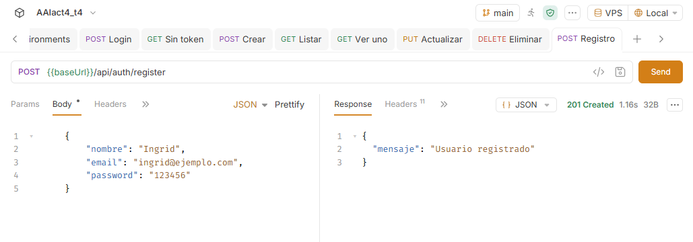
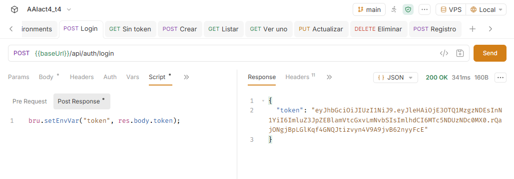
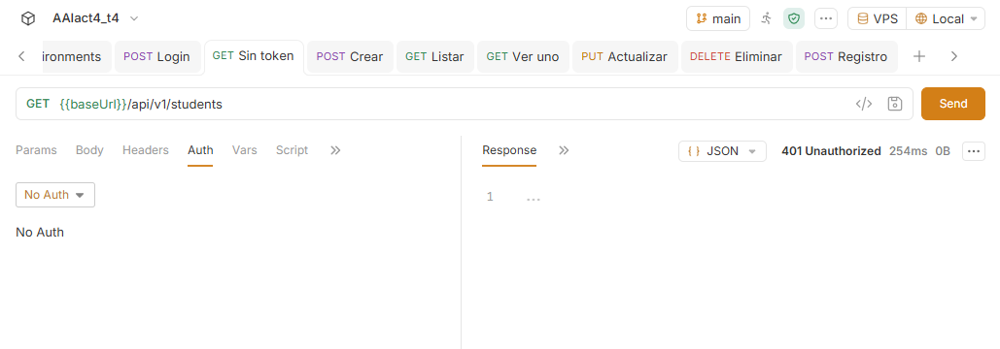
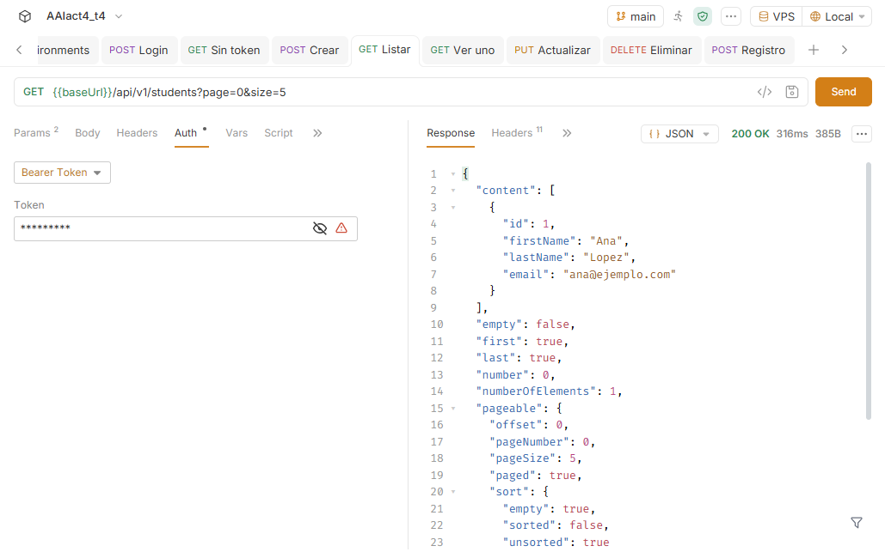
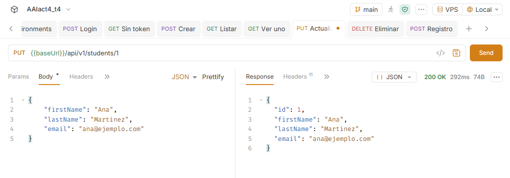
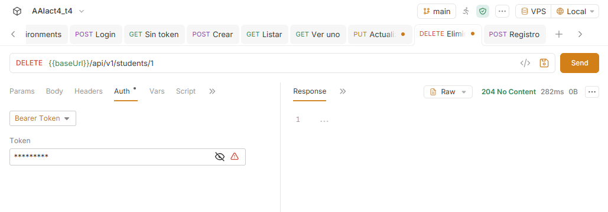
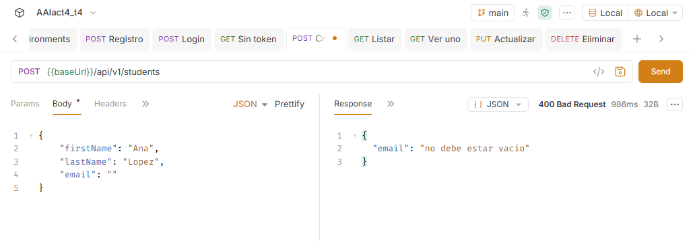
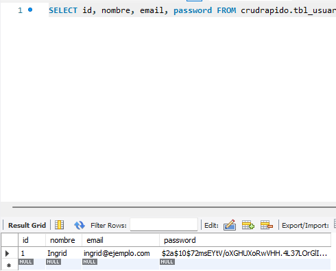

# AAIact4_t4

**Autora:** Ingrid Arcadio Aparicio

**Actividad:** Act4. API REST con Spring Security y JWT

## Descripción

API REST de estudiantes conectada a MySQL. Usa Spring Security y JWT: solo se puede usar el CRUD con un token válido, obtenido al hacer login. Las respuestas son JSON, usan DTOs y validan los datos con `@Valid`.

**API en el VPS:** http://179.197.82.130:8087

## Endpoints

| Acción | Método | Ruta | Token | Respuesta |
|---|---|---|---|---|
| Registro | POST | `/api/auth/register` | No | 201 |
| Login | POST | `/api/auth/login` | No | 200 con token |
| Listar con paginación | GET | `/api/v1/students?page=0&size=5` | Sí | 200 |
| Ver uno | GET | `/api/v1/students/{id}` | Sí | 200 o 404 |
| Crear | POST | `/api/v1/students` | Sí | 201 o 400 |
| Actualizar | PUT | `/api/v1/students/{id}` | Sí | 200 o 404 |
| Eliminar | DELETE | `/api/v1/students/{id}` | Sí | 204 o 404 |

Sin token, los endpoints del CRUD responden **401**.

### URLs completas en el VPS

Se prueban con la colección de Bruno; desde el navegador responden 401 porque requieren token.

- Registro: `POST http://179.197.82.130:8087/api/auth/register`
- Login: `POST http://179.197.82.130:8087/api/auth/login`
- Listar: `GET http://179.197.82.130:8087/api/v1/students?page=0&size=5`
- Ver uno: `GET http://179.197.82.130:8087/api/v1/students/{id}`
- Crear: `POST http://179.197.82.130:8087/api/v1/students`
- Actualizar: `PUT http://179.197.82.130:8087/api/v1/students/{id}`
- Eliminar: `DELETE http://179.197.82.130:8087/api/v1/students/{id}`

## Estructura

| Capa | Archivos |
|---|---|
| Entity | `Student.java`, `Usuario.java` |
| Repository | `StudentRepository.java`, `UsuarioRepository.java` |
| Service | `StudentService.java`, `AuthService.java` |
| Controller | `StudentController.java`, `AuthController.java` |
| DTO | `StudentDTO.java`, `RegisterDTO.java`, `LoginDTO.java` |
| Config | `SecurityConfig.java`, `ErrorHandler.java` |

## Colección de Bruno

La colección está en la carpeta `AAIact4_t4`. Tiene dos entornos: `Local` (`http://localhost:8080`) y `VPS` (`http://179.197.82.130:8087`). Al hacer **Login**, el token se guarda solo en la variable `{{token}}`.

## Capturas

### Registro

### Login

### Petición sin token (401)

### Crear

### Listar con paginación

### Actualizar

### Eliminar

### Validación (400)

### Password cifrado en MySQL

## Despliegue

Corre en el puerto **8087** del VPS, en la carpeta `~/act4`. Las Actividades 1, 2 y 3 siguen en los puertos **8082**, **8083** y **8086**.